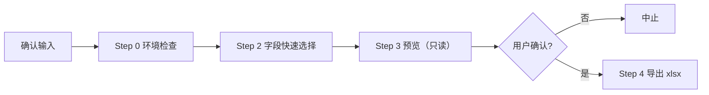

# ysb 安装/作业数据导出

按**公司 / 机主地区 / 终端类型**导出**安装数据**或**安装+作业数据**为本地 xlsx。只接受**显式调用**（用户明确要求执行此 skill 才运行），不响应任何自然语言触发。

## 两种模式

| 模式 | 参数 | 每行 | 说明 |
|---|---|---|---|
| 安装数据（默认） | 无 | 1 台设备 | 不关联作业表 |
| 作业数据 | `--with-work` | 设备×作业日 | 关联 `public.stat_iot_day`，日期范围**必填** |

## 调用前确认（必须）

1. **范围**（至少一种）：公司（名称或 id，支持多个）/ 机主地区（`--owner-province`、`--owner-city`、`--owner-county`，前缀匹配）/ 终端类型（`--terminal-types`，如 `348,363`）
2. **类型**：安装数据（默认）/ 作业数据（`--with-work`）
3. **日期**：作业模式必填 `--since/--until`（YYYY-MM-DD）；安装模式可选（按安装时间 create_time）
4. **字段**：注册表共 35 列（作业 41），默认导出 32/38 列；SIM卡号、SIM到期时间、机具幅宽默认关，按需 `--fields` 选上；分组快速选择见 Step 2

## 流程总览



## Step 0: 环境检查

```bash
python "E:/Dev/jianglei/skills/ysb-data-export/scripts/export_data.py" --check
```

检查 Python / openpyxl / `dbx` CLI / 连接 `prod_192.168.5.17_machine`，只输出 PASS/FAIL。任一 FAIL 即停止（dbx 缺失时安装：`npm install -g @dbx-app/cli`）。

## Step 1: 范围解析（公司 / 机主地区 / 终端类型）

- **公司**：直接传名称或 id，脚本自动解析；名称**精确匹配优先、模糊兜底**，命中多条时列出候选并退出（exit 2），改用 id 重试即可。
- **机主地区**：`--owner-province 江苏`（前缀匹配机主 `customer.province`），市/区县同理。
- **终端类型**：`--terminal-types 348,363`（`basic.iot_category.id`；如 348=作业监测终端P5.0、363=作业监测终端数字屏P10.1）。
- 公司/地区/类型**至少给一种**，可组合使用（AND 关系）。

## Step 2: 字段快速选择（交互）

```bash
python "E:/Dev/jianglei/skills/ysb-data-export/scripts/export_data.py" --list-fields
```

向用户展示分组（基础信息 / 机主 / 机手 / 农机 / 机具 / 其他 / 照片 / 作业），默认**全选**（"作业乡镇"、"SIM卡号"、"SIM到期时间"、"机具幅宽"默认关）。快速选择方式：

| 需求 | 参数 |
|---|---|
| 取消整组 | `--no-photos`（4 个照片列）、`--no-idcard`（机手身份证号） |
| 排除若干 | `--exclude 键1,键2`（也接受中文表头） |
| 只要若干 | `--fields 键1,键2`（精确选择，也接受中文表头） |

字段注册表定义在 `scripts/fields.json`（键↔中文表头↔分组↔SQL 表达式），增删字段只改这个文件。

## Step 3: 预览（必须，只读）

```bash
python "E:/Dev/jianglei/skills/ysb-data-export/scripts/export_data.py" \
  [--company "<公司>"] [--owner-province <省>] [--terminal-types 348,363] \
  [--with-work --since <起> --until <止>] [字段参数] --preview
```

展示：范围解析结果、字段清单、行数预估（作业模式含分片数）、5 行样本。**等待用户明确确认后**再进入 Step 4。

## Step 4: 执行导出

同一组参数 + `--yes`（`--yes` 表示用户已确认）：

```bash
python "E:/Dev/jianglei/skills/ysb-data-export/scripts/export_data.py" \
  [--company "<公司>"] [--owner-province <省>] [--terminal-types 348,363] \
  [--with-work --since <起> --until <止>] [字段参数] \
  [--out-dir <目录>] --yes
```

输出 xlsx（中文表头，表头加粗、居中、浅灰底色）：

- 单公司：`安装数据_{公司}_{时间戳}.xlsx` / `作业数据_{公司}_{时间戳}.xlsx`
- 按地区/类型（无公司）：`安装数据_{地区}_{终端348+363}_{时间戳}.xlsx`
- 多公司：一个文件、一个 sheet，行按 设备归属→机主→终端编号→作业日期 排序，文件名 `安装数据_{时间戳}.xlsx`（不带"等N家"）
- 默认落在当前目录，`--out-dir` 可改

## 参数速查

| 参数 | 说明 |
|---|---|
| `--company` | 公司名称或 id，可多次/逗号分隔（与地区/类型过滤至少给一个） |
| `--owner-province` / `--owner-city` / `--owner-county` | 机主地区过滤（前缀匹配，如 `江苏`、`南京`、`高淳`） |
| `--terminal-types` | 终端类型 id 列表（`basic.iot_category.id`，如 `348,363`） |
| `--with-work` | 作业模式（安装+作业，日期必填） |
| `--since` / `--until` | 日期范围 YYYY-MM-DD（until 含当天）；作业按 run_day、安装按 create_time |
| `--scope any` | 归属过滤并入 `install_distributor_company_id` / `distributor_company_id`（默认仅 `company_id`） |
| `--area-only` | 作业模式仅导出面积>0 的记录（默认不过滤） |
| `--preview` / `--yes` | 仅预览 / 跳过确认 |

## 数据口径（固定）

- 过滤：`status=10` 且 `is_deleted=0` 且 `is_has_owner=1`；无机主、无农机记录不导出
- 设备归属：`COALESCE(install_distributor_company_id, company_id)` → 公司名
- 终端类型：`type_id3 → basic.iot_category.name` 字典名（未命中回退 terminal_type 映射）
- 机具列：每台机具按自身品目取第一条作业类型，逗号合并且不去重；**无机具时**按农机品目取第一条；幅宽——有机具时按机具识别器取参数值 `install_iot_implement_params_value_ref.content`（参数 id=5，每机具取最新一条）合并，**无机具时用终端编号直查参数表取最新值**（有具但无参数值则留空，不回退）
- SIM：SIM卡号=`public.iot.sim`；SIM到期时间=`public.iot.comm_service_end_date`（业务/服务口径）
- 作业区位：取 `stat_iot_day` 自带 province/city/county/address，列名加"作业"前缀（与机主省市区区分）

## 注意事项

- dbx 单次查询**默认静默截断 10000 行**：脚本始终显式 `--limit` 并校验 `row_count`；作业模式自动按时间窗分批（单片≤10 万行，月→周→天自动细分）
- 结果超 Excel 单表上限（1,048,576 行）会报错，需缩小日期范围
- 脚本可独立命令行使用（不经过 agent）：不加 `--yes` 时自带确认提示

## 脚本清单

| 脚本 | 用途 | 只读/写入 |
|---|---|---|
| `scripts/export_data.py` | 环境检查 / 字段清单 / 预览 / 导出 | 库只读，写本地 xlsx |
| `scripts/fields.json` | 字段注册表（键/中文表头/分组/默认/SQL） | — |
